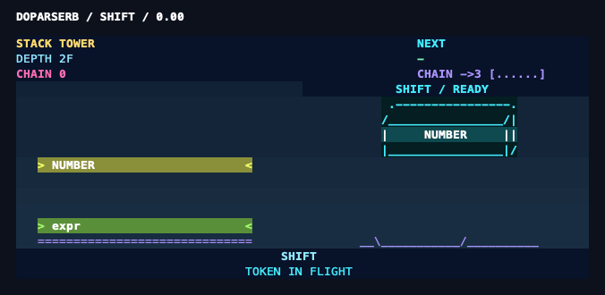

# doparserb

A parser generator built on [lrama](https://github.com/ruby/lrama), with terminal shows for generating and running parsers. Watch states form, conflicts resolve, and C code get forged. Use `play` to see shifts, reductions, chains, error recovery, and a growing stack tower.

Effects use [dopairb](https://github.com/ko1/dopairb)'s terminal and sound components: large rainbow lettering, original ASCII llamas and conflict bosses, forge sparks, shockwaves, and fireworks. During playback, token blocks drop and land, reduction blocks collide and fuse, and a repair gantry reconnects a broken bridge. Jackpot reels stop one at a time before revealing 777, coin rain, and the points earned. Original diagnostics, program output, and exit statuses remain intact.



See the [generation and playback still previews](docs/visual-preview.png) for more scenes.

```console
$ bundle exec ruby exe/doparserb -d grammar.y -o parser.c
$ cc parser.c -o parser
$ bundle exec ruby exe/doparserb play -- ./parser
```

See the [generation recording](docs/recording/generation-calc.cast), [calculator recording](docs/recording/play-calc.cast), and [recovery recording](docs/recording/play-comeback.cast). These are asciinema v2 files.
The [all-scene demo](docs/recording/demo.cast) and [ranch tour](docs/recording/ranch-tour.cast) show the remaining effects and collection.
The [watch recording](docs/recording/watch.cast) follows a conflicting grammar through an error and a corrected save.

## Install

Use the checkout and its pinned dependencies:

```console
$ git clone https://github.com/ydah/doparserb
$ cd doparserb
$ bundle install
$ bundle exec ruby exe/doparserb --dopa-help
```

Ruby 3.3 or later and a POSIX environment are required. Development uses Ruby 4.0.9, lrama master `263a3a4`, and dopairb `da3303c`, pinned in [Gemfile](Gemfile). The generated parser needs a C99 compiler and no additional runtime library.

For a runnable calculator from the checkout:

```console
$ bundle exec ruby exe/doparserb test/fixtures/runtime_calc.y -o calc.c
$ cc -std=c99 calc.c -o calc
$ bundle exec ruby exe/doparserb play -- ./calc
1+2*3
```

## Usage

```console
$ bundle exec ruby exe/doparserb -d grammar.y -o parser.c
$ bundle exec ruby exe/doparserb --dopa=calm grammar.y
$ bundle exec ruby exe/doparserb --dopa=party grammar.y
$ bundle exec ruby exe/doparserb --dopa-set flash=off,sound=off grammar.y
$ bundle exec ruby exe/doparserb --dopa=off --dopa-runtime=off grammar.y
$ bundle exec ruby exe/doparserb --dopa-meta=sidecar grammar.y -o parser.c
$ bundle exec ruby exe/doparserb play --replay=full --speed=20 -- ./parser
$ bundle exec ruby exe/doparserb play --replay=off -- ./parser < input.txt
$ bundle exec ruby exe/doparserb watch grammar.y -o parser.c
$ bundle exec ruby exe/doparserb demo
$ bundle exec ruby exe/doparserb status
$ bundle exec ruby exe/doparserb ranch
$ bundle exec ruby exe/doparserb ranch tour
```

Generation accepts lrama's arguments. `--help` and `--version` are lrama's output; `--dopa-help` explains the additional options. Put playback options before `--` and the child command after it. Use paths such as `./play` for grammar files named after a subcommand.

Generation shows run concurrently with the build and finish with a short highlight reel. Key input cancels presentation without consuming the key. `MAKELEVEL` enables quick mode; `--dopa=party` restores the full show.

`watch` builds immediately, then rebuilds when the grammar is saved. Put the existing grammar file before lrama options. It debounces edits, handles atomic replacement and temporary deletion, and keeps watching after grammar errors. The terminal badge shows the latest unresolved conflict count; Ctrl-C stops the watcher. An idle watcher releases the terminal lock so other builds can present their shows.

`play` preserves redirected descriptors, forwards input and terminal resizing, and returns the child's exit status or signal. Program output takes priority over animation. Full replay shows retained events at the requested speed; highlight replay compresses them into one or two seconds. Large backlogs are folded, and missing event history is marked approximate.

Playback prioritizes parser progress over event delivery. Sustained socket backpressure disables transport after 64 consecutive send failures. In the 10 MB benchmark, only about 0.0033% of shifts arrived and the final acceptance event was lost, although the parser completed correctly. See the [benchmark limitations](docs/bench.md#c-parser-performance) before relying on playback as a complete trace.

Running a generated parser directly prints a compact badge only when stderr is a terminal. Set `DOPAPARSER=off` to disable it, or compile with `-DDOPA_RT_DISABLE` to remove hooks, metadata, and runtime symbols entirely. `_WIN32` also compiles the runtime out.

Sidecar mode writes `parser.c.dopa.json` alongside `parser.c`. Playback searches the working directory and executable's directory for matching metadata, then falls back to numeric symbol labels when metadata is unavailable.

## Settings

Use `--dopa-set KEY=VALUE,...` or `DOPAPARSER="KEY=VALUE,..."`. Command-line settings take precedence; `NO_COLOR` always disables color.

| Setting | Values | Default |
| --- | --- | --- |
| `intensity` | `off`, `low`, `normal`, `max` | `max` |
| `motion` | `on`, `off` | `on` |
| `flash` | `off`, `soft`, `full` | `soft` |
| `sound` | `off`, `bell`, `sfx` | `sfx` |
| `duration` | `0.1`–`5` | `1` |
| `color` | `auto`, `truecolor`, `256`, `16`, `none` | `auto` |
| `trail` | `none`, `badge` | `badge` |
| `intro` | `on`, `off`, `daily` | `on` |
| `quick` | `auto`, `on`, `off` | `auto` |
| `replay` | `highlight`, `full`, `off` | `highlight` |
| `speed` | `1`–`2000` events/second | `30` |

Use `--dopa=calm` for shorter, smaller effects without flashes or sound. Add `--dopa-set motion=off` to disable animation. `NO_COLOR` removes color while preserving the text and art.

Sound effects are synthesized and cached locally. The adapter uses an available system player and falls back to the terminal bell. `sound=off` skips audio work. Flashing, motion, and sound can all be disabled before the first launch.

Runtime weaving and metadata storage affect generated files, so `--dopa-runtime=on|off` and `--dopa-meta=embed|sidecar` are command-line options only.

## Career and ranch

Interactive sessions earn XP, ranks, achievements, records, and 64 collectible llamas. Scores are for play, not a measure of code quality. Ten successful builds of the same grammar or ten consecutive error-free acceptances activate FEVER; acceptance after recovery earns COMEBACK.

Profiles live at `$XDG_STATE_HOME/doparserb/profile.json`, defaulting to `~/.local/state/doparserb/profile.json`. Set `DOPAPARSER_PROFILE` to a custom path or `off` to disable persistence. Updates use a stable lock and atomic replacement. Corrupt profiles are preserved. Demos and noninteractive commands never read or update career storage.

`DOPAPARSER_SEED` fixes bonus draws for repeatable demonstrations. `DOPAPARSER_DEBUG` names an optional file for presentation errors.

## Compatibility and development

With `--dopa=off --dopa-runtime=off`, artifacts and diagnostics match the pinned lrama revision. Default generated C includes runtime hooks; it remains independent of terminal availability, random draws, time, environment settings, and profiles. Hooks observe parser state and symbol IDs without inspecting semantic values.

```console
$ bundle exec rake test
$ bundle exec ruby benchmark/generation.rb
$ bundle exec ruby benchmark/generation_show.rb
$ bundle exec ruby benchmark/play_relay.rb
$ bundle exec ruby benchmark/runtime.rb
$ bundle exec ruby docs/recording/generation.rb
$ bundle exec ruby docs/recording/play.rb
$ bundle exec ruby docs/recording/career.rb
$ bundle exec ruby docs/recording/watch.rb
```

Tests cover the upstream comparison matrix, GCC and clang, 10,000 randomized JSON inputs, terminal reconstruction, profile concurrency, sound cancellation, and every ranch variant. See the [design specification](spec.md), [milestone reports](docs/progress.md), and [measured performance](docs/bench.md) for details and limitations.

Windows playback and integration into CRuby's own bootstrap build are outside this release. The implementation has been exercised locally on macOS; Linux execution is not yet verified locally.

## License

[MIT](LICENSE.txt). The terminal test support includes MIT-licensed code adapted from dopairb, with attribution retained in the source.
