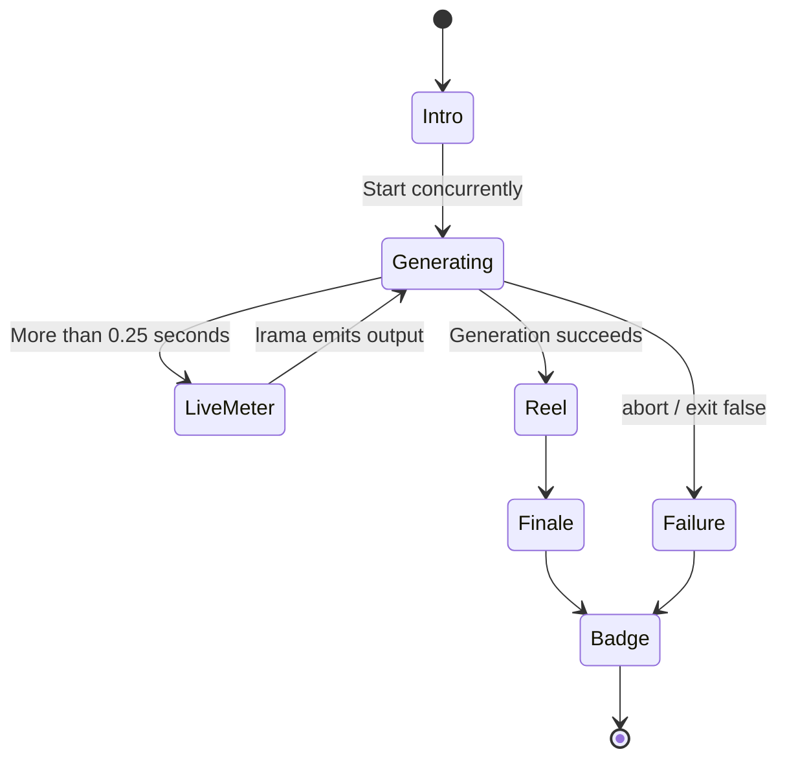
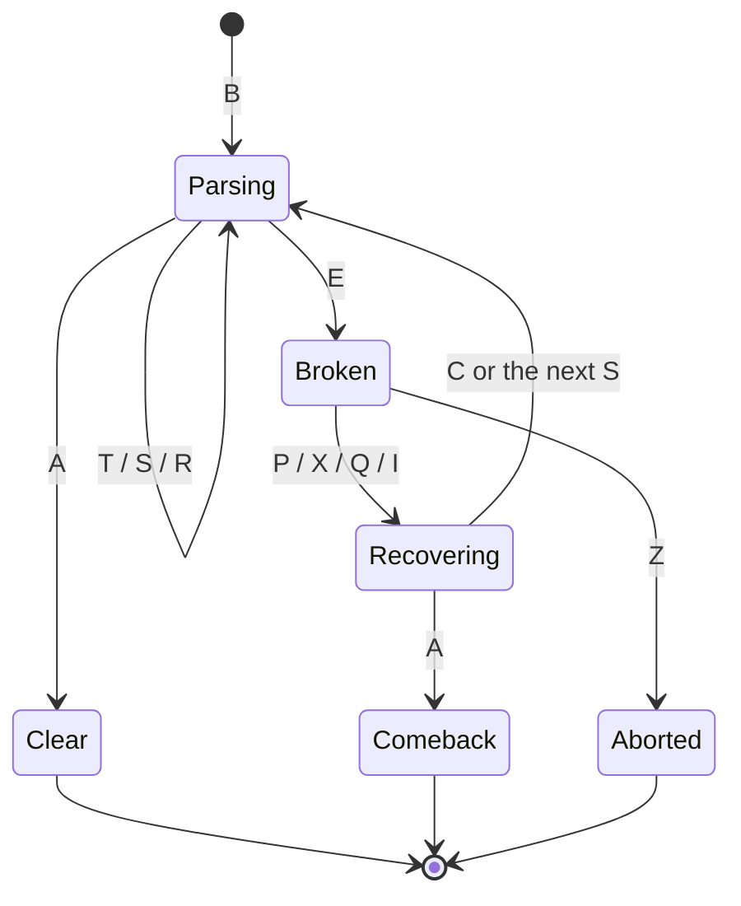

# doparserb design specification

Created: 2026-11-09
Status: design v0.3 (M0–M9 implemented; validation limits recorded in §13 and the milestone reports)
Baseline: lrama master `263a3a4b99b0b4856b9993b682b563369d3b51ea`, dopairb `da3303ccb7e1d75ee5da25fc86449a01b8a584a1`, Ruby 3.3 or later
Related document: [M0 findings](docs/m0-findings.md)

## Decisions confirmed in M0

- Use the lrama master revision above as the compatibility baseline. Pin the commit in the development Gemfile to distinguish it from the released 0.8.0 gem.
- Normalize object addresses in `-t` output, measured durations, and caller backtrace differences only inside comparison tests. Never rewrite actual diagnostic output.
- Test byte-for-byte equality with lrama using `--dopa-runtime=off`. For default noninteractive execution, compare stdout, stderr, and exit status; separately verify that runtime-enabled artifacts do not depend on terminal availability.
- Test linking multiple parsers by renaming their symbols with the C preprocessor instead of using `api.prefix`, which upstream does not implement.
- Discover sidecars by searching the working directory and the executable's directory for `*.dopa.json` files with a matching digest. Fall back to symbol and rule numbers when no match is available.
- Use the exact anchors and rule-number mapping recorded in the M0 findings. C rule numbers are `Grammar::Rule#id + 1`.
- `sample/parse.y` is small, so use a separate large grammar to test the live meter.

---

## 0. Terminology

| Term | Meaning |
| --- | --- |
| Generation time | From reading a grammar file (`.y`) through computing states and writing the C parser |
| Parse time | While the generated C parser (`yyparse`) analyzes input |
| Show | The complete presentation. An individual effect is a scene; a single line retained in scrollback is a badge. |
| Dopamine seeker | The intended audience: developers who want feedback on every token and enjoy records and rare effects |
| Engine | The dopairb rendering, sound, and terminal components: `Canvas`, `Font`, `Color`, `Stage`, `Term`, and `Sound` |

## 1. Overview

**doparserb** is a LALR(1)/IELR(1) parser generator built on lrama. It preserves lrama's grammar files, options, and error messages while turning both kinds of parsing into a show.

1. **Generation show:** present grammar scanning, state construction, conflict battles, and the forging of C code.
2. **Parse show:** show the generated parser stacking shifted tokens into a tower, merging blocks through reductions, building chains, recovering from errors, and accepting input with STAGE CLEAR.

**Implementation approach**

- Depend on lrama as a gem without forking it. Observe milestones through a `Lrama::Command` subclass and `Module#prepend`. Isolate dependencies on lrama internals in `lrama_adapter.rb`.
- Add parse-time effects by weaving hook lines into lrama's `template/bison/yacc.c` skeleton. Do not maintain a complete copied template.
- Reuse dopairb's rendering, sound, and terminal components. Isolate the dopairb dependency in `engine.rb`.
- Keep C fast and quiet; let Ruby supply the spectacle. The generated parser sends events to a separate `doparserb play` process instead of drawing large animations itself.

## 2. Experience principles

1. **Respond to every token.** Give grammar tokens, input tokens, shifts, and reductions a small reaction.
2. **Make milestones stronger.** Emphasize chains, power-of-two state counts, resolved conflicts, repairs, and acceptance.
3. **Preserve artifacts and output.** With both presentation and runtime instrumentation disabled, doparserb produces the same bytes as lrama. Even with presentation enabled, preserve every character and the ordering of lrama's warnings, errors, traces, and reports.
4. **Keep artifacts independent of the environment.** Terminal availability, randomness, time, and configuration files must not affect generated `.c` files. Only explicit command-line options may change them.
5. **Do not slow down or break builds.** Contain presentation exceptions and preserve lrama's exit status. Key input ends presentation immediately.
6. **Do not slow down the parser.** Disabled runtime hooks have nearly zero cost and can be removed entirely at compile time.
7. **Do not mock failure.** Error scenes identify the error type without disparaging the user.
8. **Scores are for play.** They do not evaluate grammar or code quality. Do not disproportionately reward huge grammars or inputs.
9. **Let users choose the intensity.** Default to full intensity, with independent controls for flashing, motion, sound, and duration. Flashing can be suppressed from the first launch.

The renderer uses large gradient lettering, original ASCII sprites, colored stack blocks, sparks, expanding shockwaves, and independently stopping jackpot reels. Standard generation scenes occupy up to 18 rows and playback up to 16; low intensity uses up to six. Frames always fit within the available terminal height. Compact sprites preserve their outlines when the full artwork cannot fit.

Live playback animates between event boundaries without waiting for an entire scene or replaying each event's sound. The renderer caps playback at 40 frames per second. Program output and cancellation interrupt the animation. Standalone rendering uses Unicode-neutral braille pixels with colored cell backgrounds; ambiguous block glyphs retain the upstream width fallback. NO_COLOR removes color and styling while keeping the text and motion controls independent.

## 3. Architecture

```mermaid
flowchart LR
  subgraph GEN["Generation: doparserb grammar.y"]
    CLI["CLI\nArgument routing"] --> CMD["Doparserb::Command\n(Lrama::Command subclass)"]
    CMD -->|prepend / decorators| LA["LramaAdapter"]
    LA --> BUS["EventBus"]
    BUS --> GSHOW["GenShow\nIntro / live meter / reel / finale"]
    CMD --> WEAVE["Weaver\nInsert hooks into yacc.c"]
    WEAVE --> OUT[("parser.c\n+ dopa_rt + metadata")]
  end
  subgraph RUN["Parse time"]
    PROG["User program\nyyparse()"] -->|DOPA_* hooks| RT["dopa_rt (C)"]
    RT -->|One-line badge| TTY1[("Terminal")]
    RT -->|Events (UNIX DGRAM)| PLAY["doparserb play\nPTY relay + PlayShow"]
    PLAY --> TTY2[("Terminal")]
  end
  GSHOW --> ENG["Engine\n(dopairb components)"]
  PLAY --> ENG
  GSHOW --> PROF[("profile.json")]
  PLAY --> PROF
```

The parse-time show has three modes.

| Mode | Condition | Behavior |
| --- | --- | --- |
| off | No terminal, `DOPAPARSER=off`, or `-DDOPA_RT_DISABLE` | No presentation output |
| badge (standalone) | Program runs directly with terminal stderr | One badge at the end of parsing; no animation |
| play (full show) | Launched with `doparserb play -- ./prog` | Receive events and show the tower, chains, recovery, and other scenes |

## 4. Components

```text
doparserb/
  exe/doparserb
  lib/doparserb.rb
  lib/doparserb/version.rb
  lib/doparserb/cli.rb                 # Route lrama options, --dopa-* options, and subcommands
  lib/doparserb/config.rb              # Configuration: CLI > environment > defaults
  lib/doparserb/event.rb               # Event: kind, strength, info
  lib/doparserb/event_bus.rb           # Generation-event intake using a thread-safe Queue
  lib/doparserb/lrama_adapter.rb       # All dependencies on lrama internals
  lib/doparserb/engine.rb              # All dependencies on dopairb
  lib/doparserb/tty_lock.rb            # Prevent terminal contention during parallel builds
  lib/doparserb/gen/collector.rb       # Generation-event aggregation: GenStats
  lib/doparserb/gen/show.rb            # Intro, live meter, reel, and finale progression
  lib/doparserb/gen/scenes/*.rb        # Generation scenes
  lib/doparserb/runtime/anchors.rb     # Weaving anchor inventory
  lib/doparserb/runtime/weaver.rb      # Weave hooks into yacc.c
  lib/doparserb/runtime/meta.rb        # Symbol and rule metadata as JSON
  lib/doparserb/runtime/dopa_rt.c.erb  # C runtime embedded in generated output
  lib/doparserb/play/launcher.rb       # Child launch, PTY relay, signals, and exit status
  lib/doparserb/play/protocol.rb       # Event-stream parsing
  lib/doparserb/play/tower.rb          # Pure STACK TOWER model
  lib/doparserb/play/show.rb           # Highlight/full replay progression
  lib/doparserb/play/scenes/*.rb       # Parse-time scenes
  lib/doparserb/game.rb                # SCORE / CHAIN / COMBO / FEVER / random bonuses
  lib/doparserb/profile.rb             # Career: XP, level, records, and daily streak
  lib/doparserb/ranch.rb               # LLAMA RANCH collection
  lib/doparserb/achievements.rb        # Achievements
  lib/doparserb/sound_bank.rb          # New effects using the engine's synthesizer
  test/...
```

Dependencies: `lrama ~> 0.8.0` and `dopairb >= 0.5`.
The development Gemfile pins Git references to the commits listed above; see §15.
Add no other runtime dependencies.

## 5. Generation show

### 5.1 Observing lrama

`Doparserb::Command` subclasses `Lrama::Command` without changing `execute_command_workflow`. Emit events before and after its stages.

| Observation point (lrama 0.8.0) | Mechanism | Events or measurements |
| --- | --- | --- |
| `Lrama::Lexer#next_token` | Observe the return value with prepend | Total tokens and counts by kind: SCAN |
| `Command#build_grammar` | Override and call `super` | Rule, terminal, and nonterminal counts; parameterized rules; `%inline` |
| `Tracer::Duration#report_duration(name)`, mixed into `States` | Prepend to `States` | Start, completion, and duration of phases such as `compute_lr0_states`, `compute_look_ahead_sets`, and `split_states` |
| `Tracer#trace_state_list_append` | Decorate the Tracer | Notification whenever a state is added, for the live meter |
| `States#sr_conflicts_count` and related counts; each `State#resolved_conflicts` | Read after computation | Unresolved conflicts and conflicts resolved by precedence |
| `States#validate!` | Override | `%expect` mismatch; lrama calls `exit false` |
| `Command#render_output` | Override | Output lines and bytes; whether a header was generated |
| `Logger#warn` / `#error` | Inject a wrapped Logger | Warning/error counts; pass message text through unchanged |
| `Warnings#warn` | Override | Completion of the warning phase |
| `abort` / `SystemExit` | Catch outside `run`, then re-raise | Generation failure, such as GRAMMAR BREAK |

Generation only enqueues events on EventBus. GenShow renders them in another thread; do not render inside the generation workflow.

### 5.2 Events and scenes

Strength progresses from small to medium, large, and extra large (§8).

| Event | Trigger | Scene | Strength |
| --- | --- | --- | --- |
| TITLE | Start on an interactive terminal | Giant `DOPARSERB` lettering drops in; a llama runs along the loading strip | Large |
| SCAN | Lexical analysis completes | Grammar tokens scroll rapidly with sparks: `SCAN 1,234 TOKENS` | Small, aggregated |
| LOADED | Grammar construction completes | Stamp `RULES 120`, `TERMS 85`, and `NTERMS 60` in sequence | Medium |
| EVOLVE | Parameterized rules are instantiated | `option(X)` glows and evolves into `option_expr`: `EVOLVE x12` | Medium |
| FUSION | `%inline` expands | Two blocks fuse: `INLINE FUSION x3` | Medium |
| STATES | Construct LR(0) states | Large count-up numbers, with power-of-two milestones: `64 STATES!`, `256 FULL BYTE!!`, `0x400 OVERFLOW!!!`, `4096 PAGE SIZE!!!` | Large |
| LOOKAHEAD | Compute lookahead sets | A scan line sweeps across the state table: `LOOKAHEAD LOCK` | Medium |
| SPLIT | IELR adds states | States divide like cells: `IELR SPLIT +12` | Large |
| SLASH | Precedence/associativity resolves conflicts | One slash per resolution: `PRECEDENCE SLASH x45` | Medium; large at 32 or more |
| BOSS | Unresolved conflicts remain | A boss appears with HP equal to the unresolved count: `S/R x3  R/R x1`. A matching `%expect` settles it with `TAMED`. | Large |
| FLAWLESS | Zero unresolved conflicts, including matching `%expect` cases | Rainbow `FLAWLESS!! NO CONFLICT` | Extra large |
| FORGE | An output file is written | Anvil and sparks: `FORGED calc.c 1,872 LINES` | Large |
| EXTRA | A header, report, or diagram is written | Fold `+HEADER`, `+REPORT`, and `+DIAGRAM` into the FORGE subtitle | Small |
| WARNING | lrama emits a warning | Yellow warning light: `WARNING x2`; leave lrama's message unchanged | Medium |
| NEW ABILITY | First use of IELR, `%inline`, parameterized rules, `-e`, or another feature | Unlock scene: `NEW ABILITY: IELR` | Large |
| RECORD | Improvement over the previous result for the same grammar | `CONFLICTS 3 → 0  FIXED!`, `FASTER! -38%`, or `NEW RECORD: STATES` | Extra large |
| CRITICAL / JACKPOT | Random bonus on success: approximately 1/10 and 1/67 | Slashes and a red flash for x2/x4/x8; a 7-7-7 slot result for x16 | Large / extra large |
| FINALE | Generation succeeds | Slam in totals, count up the score, stamp the rank, then fireworks | Extra large |
| GRAMMAR BREAK | Grammar syntax error | A crack at the input position: `GRAMMAR BREAK @12:5` | Large |
| EXPECT MISMATCH | `%expect` mismatch | The boss escapes: `EXPECTED 2, FOUND 3` | Large |
| VALIDATION BREAK | Other validation error | A short red flash and `FAILED` | Large |

Compare with the latest result stored in the profile under the grammar file's realpath: unresolved conflicts, states, and generation duration. Show a speed improvement only when it is at least 10% and 5 ms faster, to avoid rewarding measurement noise.

### 5.3 Timing

Small grammars finish in tens of milliseconds, too quickly to show each phase in real time. Use three stages.

1. **Intro, concurrent with generation:** GenShow starts TITLE immediately while generation proceeds. This stage lasts as long as the slower of the intro and generation.
2. **Live meter, for slow generation only:** After 0.25 seconds, show the state count and current phase in a single CHARGING line. After three seconds, switch to an elapsed-time display with less motion. Clear the meter before lrama writes anything to stderr.
3. **Highlight reel, after generation:** Once all lrama output has finished, replay a compressed summary. Prefer stronger events, fold weaker ones into subtitles, and finish with FINALE.

| Item | Default (`max`) | Quick mode |
| --- | --- | --- |
| Intro | 0.6 seconds | None |
| Reel and finale | At most 2.5 seconds total, multiplied by `duration` | At most 0.8 seconds |
| Retained output | One-line badge | One-line badge |

Enable quick mode automatically when `MAKELEVEL` is present, indicating execution under make. `--dopa=party` overrides it.

Example badge:

```text
✦ FLAWLESS!! ✦ calc.y → calc.c  STATES 29  +1,240  LV 5
```

### 5.4 Coexistence with normal output

- Draw effects in the engine's temporary `Stage` area and clear them afterward. Scrollback retains only lrama output and one badge.
- Emit lrama's traces, warnings, and errors exactly as lrama writes them, before starting the reel.
- Effects still run with `--trace` or `-v`, but disable the live meter so it does not mix with trace lines.
- Render to stderr only when it is a terminal. Otherwise disable presentation. Never write effects to stdout.

### 5.5 Failure

lrama fails with `abort`, which prints a message and raises `SystemExit`, or with `exit false`. Catch `SystemExit`, show a short failure scene lasting at most one second after the message, and re-raise with the same status. Preserve the selected upstream's behavior concerning unwritten output files on failure.

## 6. Parse-time show

### 6.1 Weaving the skeleton

`Weaver` reads lrama's `template/bison/yacc.c`, inserts hook lines according to the anchor inventory, and writes the modified template into a temporary directory. Prepend an override of private `Lrama::Output#template_file` to use it. Leave header templates (`yacc.h` and `_yacc.h`) unchanged.

Every anchor is a string that must occur exactly once, or a specified number of times, in the template. Validate counts when loading the template. If any count differs, stop with a clear unsupported-lrama error as required by R7 (§10). The table below records the original candidate hooks; the exact strings, compound anchors, positions, and corrected state/depth values in the [M0 findings](docs/m0-findings.md) take precedence.

| Hook | Candidate template anchor | Position | Inserted hook |
| --- | --- | --- | --- |
| Runtime body | Comment block containing `\| yyparse.  \|` | Before | `<%= ::Doparserb::Runtime.c_source %>` |
| Parse state | `int yylen = 0;` within the compound M0 declaration anchor | After declaration | `DOPA_DECL();` |
| Begin | `YYDPRINTF ((stderr, "Starting parse\n"));` | After | `DOPA_BEGIN();` |
| Lookahead | `YY_SYMBOL_PRINT ("Next token is", yytoken, &yylval, &yylloc` | After every occurrence | `DOPA_TOKEN(yytoken, &yylloc);` |
| Shift | `YY_SYMBOL_PRINT ("Shifting", yytoken, &yylval, &yylloc` | After | `DOPA_SHIFT(yytoken, yyn, yyssp - yyss + 1);` |
| Reduce | `YY_REDUCE_PRINT (yyn` | Before | `DOPA_REDUCE(yyn, yylen, yystate, yyssp - yyss);` |
| Syntax error | `++yynerrs;` following `yyerrlab:` | After | `DOPA_ERROR(yystate, yytoken, &yylloc);` |
| Recovery pop | The two lines containing `after_pop_stack_function(` | After | `DOPA_POP(n, yyssp - yyss);` |
| Error-token shift | `YY_SYMBOL_PRINT ("Shifting", YY_ACCESSING_SYMBOL (yyn)` | After | `DOPA_ERROR_SHIFT(yyn, yyssp - yyss + 1);` |
| Repair plan (`-e`) | `rep_terms = yyrecover (` | After | `DOPA_REPAIR_PLAN(rep_terms ? rep_terms->length : 0);` |
| Repair-token insertion | `"Next error recovery token is"` trace, after assignment to `yytoken` | After | `DOPA_REPAIR_TOKEN(yytoken);` |
| Repair completion | `"Error recovery is completed\n"` | After | `DOPA_REPAIR_DONE();` |
| Accept | `yyacceptlab:` | After | `DOPA_ACCEPT();` |
| Abort | `yyabortlab:` | After | `DOPA_ABORT();` |
| Stack exhaustion | `yyexhaustedlab:` | After | `DOPA_EXHAUSTED();` |
| End | `yyreturnlab:` | After | `DOPA_END();`, which flushes |

Repair anchors are inside ERB conditionals, so they and the inserted hooks do not appear in generated output without `-e`. Keep the inserted lines inside those same conditionals.

The implementation validates 21 anchors: the 18 confirmed in M0, plus EOF preview, scanner-reported errors, and explicit `YYERROR`. It also flushes immediately before the lexer call. The `R` event records the state and depth **before** reduction; its expected resulting depth is `depth - len + 1`. User actions can abort, accept, or raise `YYERROR` before that reduction completes. Recovery pop events supply the actual post-pop depth.

With `--dopa-runtime=off`, do not weave anything. Generated files must then be byte-identical to lrama's output.

### 6.2 C runtime (`dopa_rt`)

Embed the runtime entirely in the generated `.c` file. Require no external library or additional linker option.

**Compile-time controls**

- With `-DDOPA_RT_DISABLE`, all `DOPA_*` macros expand to nothing, and the runtime body and metadata are excluded from compilation.
- Treat `_WIN32` as `DOPA_RT_DISABLE`; the first release targets POSIX only.

**Runtime selection**

Choose once at the start of `yyparse` and keep the result in a local variable:

1. `DOPAPARSER=off`: off.
2. `DOPAPARSER_FD` identifies a valid socket: play sink.
3. stderr is a terminal and `TERM` is not `dumb`: badge sink.
4. Otherwise: off.

Each hook passes through a single `if (yydopa.on)` branch. This is its only cost when disabled.

**Implementation constraints**

- Runtime helper functions and shared variables are `static`, with names beginning `yydopa_`, so independently named parsers can link into one program without collisions. Use the approved C macro-renaming test rather than unsupported `api.prefix`.
- Do not call `malloc` or stdio on the hot path. Accumulate events in a 2 KB buffer local to `yyparse`, and send them using `write`/`send`.
- Never inspect user semantic values (`YYSTYPE`). Handle only symbol-kind numbers and locations (line and column).
- Use C99 and add no warnings under `-Wall -Wextra`.
- Global initialization must be idempotent. Use C11 atomics when available.

**Play sink transport**

- `doparserb play` creates an `AF_UNIX`/`SOCK_DGRAM` socketpair. Message boundaries are preserved: one chunk is one datagram.
- Each chunk is at most 2048 bytes, respecting the macOS default limit. Never split an event line between chunks.
- Send nonblockingly with `MSG_DONTWAIT`. Prevent SIGPIPE using `MSG_NOSIGNAL` on Linux and `SO_NOSIGPIPE` on macOS.
- When strict POSIX headers hide `MSG_DONTWAIT`, set `O_NONBLOCK` on the dedicated event descriptor instead. This changes that descriptor's shared file status; it must be reserved for the event transport. Modern macOS also supplies `MSG_NOSIGNAL` under POSIX.1-2008.
- Discard chunks that cannot be sent, count the discarded events, and report the count as `D <n>` in the next chunk. Stop sending for that process after 64 consecutive failures.
- `DOPAPARSER_FLUSH` selects the flush policy. `eager`, set by play when the child's stdin is a terminal, flushes immediately before every `yylex` call so events do not remain buffered while interactive input is awaited. `batch` flushes only when the buffer is full and at `DOPA_END`.

**Badge sink**

- Write exactly one line to stderr at `DOPA_END`; do not animate.
- If stdout is also a terminal, call `fflush(stdout)` before writing the badge to preserve order. Do not touch stdout when it is not a terminal.
- Suppress color under `NO_COLOR`. Suppress the badge entirely when `TERM=dumb`.

```text
✦ STAGE CLEAR! ✦ 42 TOKENS · MAX CHAIN 5 · TOWER 12F
✖ SYNTAX BREAK @3:7 · RECOVERED · COMEBACK!
```

### 6.3 Metadata

Generate JSON describing symbols and rules so play can display their names. Embed it as a C string constant by default (`--dopa-meta=embed`). With `--dopa-meta=sidecar`, write `<output-name>.dopa.json` and retain only the digest in C.

```json
{
  "v": 1,
  "grammar": "calc.y",
  "digest": "3f9a1c2e00000000000000000000000000000000000000000000000000000000",
  "generator": "doparserb 0.1.0 / lrama 0.8.0",
  "symbols": [{"id": 0, "name": "\"end of file\"", "term": true}],
  "rules": [{"id": 4, "lhs": 9, "rhs": [9, 5, 9], "text": "expr: expr '+' expr"}],
  "states": 29
}
```

Store only the basename in `grammar`, avoiding build-machine absolute paths in the executable and preserving reproducibility. Rule numbers must match C's `yyn`, the index into `yyr1`/`yyr2`; M0 confirmed the mapping `Grammar::Rule#id + 1`.

The digest is SHA-256 of the deterministic metadata payload before its `digest` field is added. The eight-character parser identifier is its prefix; sidecar matching uses the complete digest.

For sidecars, search the working directory and executable's directory for `*.dopa.json`, match the digest, and use numeric symbol/rule identifiers if no valid match is found.

### 6.4 Event protocol v1

The protocol uses text lines. Every chunk starts with a line identifying its parser and parse invocation.

```text
F <parser:8hex> <pid> <parse_id>
<event lines...>
```

| Code | Arguments | Meaning |
| --- | --- | --- |
| `M` | parser offset total, newline, then bytes | Metadata fragment; sent once per parser in a process |
| `B` | None | Begin `yyparse` |
| `T` | sym line col | Observe a lookahead token |
| `S` | sym state depth | Shift |
| `R` | rule len state depth | Observe a reduction before its action; state and depth are pre-reduction values |
| `E` | state sym line col | Detect a syntax error |
| `P` | n depth | Pop n levels during error recovery |
| `X` | state depth | Shift the `error` token |
| `Q` | n | Plan a repair inserting n tokens |
| `I` | sym | Insert a repair token |
| `C` | None | Complete a repair |
| `A` | None | Accept |
| `Z` | None | Abort (`YYABORT`) |
| `O` | None | Stack exhaustion |
| `D` | n | Events discarded because sending failed |

### 6.5 `doparserb play`

```console
$ doparserb play [options] -- ./prog [arguments...]
```

**Child launch and relay**

| Parent descriptor | Child receives | Parent responsibility |
| --- | --- | --- |
| stdin is a terminal | PTY slave | Relay keys to the PTY in raw mode. A key ends presentation immediately and is still forwarded. |
| stdin is not a terminal | Inherit unchanged | No relay; preserve EOF semantics |
| stdout/stderr is a terminal | The same PTY slave | Relay output immediately, retiring presentation before writing it |
| stdout/stderr is not a terminal | Inherit unchanged | No relay |

- Use `PTY.open` and `Process.spawn`, not `PTY.spawn`, to assign each descriptor according to the table.
- Pass the child's event socket as `DOPAPARSER_FD=<n>`. Set `DOPAPARSER_FLUSH=eager` when the child has terminal input.
- On SIGWINCH, synchronize the PTY window size.
- Return the child's exit code unchanged. If it dies from a signal, terminate play with the same signal, falling back to `128 + n` if necessary.
- If no descriptor is a terminal, simply execute the child without presentation.

**Rendering priority:** child output always wins. Clear the temporary presentation area before relaying output. At the next suitable boundary, either resume the presentation or discard it.

### 6.6 STACK TOWER and scenes

Display the parser stack as a vertical tower. Each block has an abbreviated symbol name and a symbol-specific color. A NEXT box in the upper right previews the lookahead token.

| Event | Scene | Strength |
| --- | --- | --- |
| T (lookahead) | Preview the next block in NEXT | Small |
| S (shift) | Drop a block onto the tower with landing sparks and a token-name pop | Small |
| R (reduce) | Light up the top n blocks and merge them into the LHS block; show `+score` | Small; medium when n ≥ 4 |
| CHAIN | Count consecutive reductions after a shift: `3 CHAIN!`; raise the sound pitch with each reduction | Medium; large from 5, extra large at 8, 16, and 32 |
| Empty reduction | A block appears out of thin air: `FROM NOTHING` | Small |
| TOWER | Set a new maximum depth; celebrate powers of two: `TOWER 32F!` | Medium |
| E (syntax error) | Shake and crack the tower: `SYNTAX BREAK @3:7`. Leave expected-token explanations to the program's `yyerror`. | Large |
| P (pop) | Collapse n tower levels: `-3F` | Medium |
| X (error shift) | Land an error block on the rubble: `RECOVERY` | Large |
| Q / I / C (repair) | Inserted tokens fly into gaps: `+ ')' INSERTED`, then `AUTO REPAIR!` on completion | Extra large |
| A (accept) | The tower glows and rises away; show `STAGE CLEAR!` and totals | Large |
| A after an error | `COMEBACK!` | Extra large |
| Z / O | End neutrally with `ABORTED` / `STACK EXHAUSTED` | Large |
| Random bonuses | On reduction, CRITICAL at approximately 1/10 and JACKPOT at 1/67 | Large / extra large |
| Cumulative totals | `1K TOKENS!`, `1M TOKENS!!!` | Large |

**Replay modes**

| Mode | Behavior |
| --- | --- |
| `highlight` (default) | Compress the received events into one or two seconds. Fast-forward intermediate action (`▶▶ x240`) and end with one strongest highlight. |
| `full` | Replay one event at a time at `--speed`, defaulting to 30 events/second. This spectator mode also supports learning LR parsing. |
| `off` | No animation; only the final one-line badge |

Rendering must never make the parser wait. Events arrive asynchronously, and the display consumes them at its own pace. If too many accumulate, fold older events into summary statistics.

## 7. Game system

Keep all numerical values in constants in `game.rb`, with unit tests fixing their behavior.

### 7.1 Generation scoring

| Element | Behavior |
| --- | --- |
| SCORE | States: `100 × log2(states + 1)`; precedence resolution: 50 each; matching `%expect`: 500; FLAWLESS: 1,000; improvement over the previous result: 2,000; first use of a feature: 300 |
| BUILD STREAK | Consecutive generations of the same grammar without a failure; FEVER at 10 or more doubles the score |
| Random bonuses | CRITICAL: approximately 1/10, x2/x4/x8; JACKPOT: 1/67, x16 |

Floor the summed base score before applying multipliers. Draw JACKPOT first, then CRITICAL when JACKPOT did not win. Keep build streaks per realpath; failure resets that grammar's streak. First-use feature awards are recorded only after successful generation.

### 7.2 Parse-time scoring

| Element | Behavior |
| --- | --- |
| CHAIN | Consecutive reductions between shifts |
| COMBO | Consecutive error-free acceptances in the same play session; a syntax error breaks it |
| COMEBACK | Acceptance after an error; COMBO restarts at one |
| FEVER | COMBO of at least 10; double points and a rainbow HUD until the next error |
| SCORE | Shift: 10; reduce: `10 × len`; CHAIN bonus; acceptance: 500; repair: 300; COMEBACK: 1,000. Apply square-root diminishing returns to token points per parse. |

The cumulative token component is `floor(10 × sqrt(shifts + sum(reduced RHS lengths)))`; each event awards its increase. CHAIN milestones 3, 5, 8, 16, and 32 award 30, 50, 100, 300, and 1,000 points. Reduction events can draw random bonuses. Transport loss notices mark results approximate without creating a new parse or breaking a successful acceptance.

### 7.3 Ranks

Stamp a rank based on the session score in the generation finale and play's ending screen. Keep every title positive, including lower ranks.

| Rank | Title |
| --- | --- |
| S | LEGENDARY LLAMA |
| A | GRAMMAR HERO |
| B | PARSER PILOT |
| C | STACK ROOKIE |

Rank thresholds are C from 0, B from 1,024, A from 4,096, and S from 16,384 points.

### 7.4 Career

- Store the profile at `~/.local/state/doparserb/profile.json`, respecting `$XDG_STATE_HOME`. Override with `DOPAPARSER_PROFILE=path`; use `off` to disable persistence.
- Store lifetime XP, level, best score, best CHAIN, highest TOWER, daily streak, the latest result for each grammar, achievements, and llamas.
- Level thresholds follow powers of two: LV 2 = 512 XP, LV 3 = 1,024 XP, LV 4 = 2,048 XP, and so on.
- Noninteractive execution, including CI and pipelines, must not touch the profile.
- Use a file lock and rename from a temporary file to make writes safe during parallel builds.

Hold the lock across reading the current history, calculating rewards, and replacing the file. Keep profile files private and preserve corrupt, unsafe, oversized, or unsupported-version files. Daily intros are claimed under the same lock. Status reads require interactive stderr, and demos never claim intros or update careers. Disabled storage keeps only ephemeral session state.

### 7.5 LLAMA RANCH

Collect llamas in honor of lrama.

- Provide 64 llamas (2^6): four coat colors × four accessories × four backgrounds. Draw all of them procedurally with half-blocks; bundle no image files.
- Award llamas on level-up, JACKPOT, achievement unlocks, and approximately 1/50 of successful runs (`LLAMA DROP!`). Prefer uncollected llamas.
- `doparserb ranch` displays a ranch where collected llamas walk around. `doparserb ranch tour` presents every llama in a slideshow, using silhouettes for uncollected ones.
- Use original designs; do not imitate existing characters, logos, or works.

Combine simultaneous reward triggers into one new llama per completion. Once all 64 are owned, further triggers retain the complete collection without duplicates.

### 7.6 Achievements

Examples: `FIRST FORGE` (first generation), `FLAWLESS x10`, `IELR MASTER`, `INLINE ALCHEMIST`, `EVOLUTIONIST` (parameterized rules), `BOSS TAMER` (matching `%expect`), `CONFLICT SLAYER` (conflicts reduced to zero since the previous result), `TOWER 64F`, `CHAIN 16`, `AUTO REPAIRED`, and `1M TOKENS`.

## 8. Effect strength and priority

Strength increases from **small** (each token) to **medium** (milestones), **large** (phase completion and acceptance), and **extra large** (records, comebacks, and repairs). When several events fire together, play only the strongest and fold the rest into subtitles, such as `FORGED calc.c  +HEADER +REPORT`. Do not queue a long sequence of delayed scenes. Follow dopairb Director's priority policy; reuse engine behavior where its API permits, subject to the M0 adapter findings.

## 9. Configuration

### 9.1 Command line

```console
$ doparserb -d calc.y -o calc.c          # lrama behavior, with a generation show on a terminal
$ doparserb --dopa=calm calc.y           # Low intensity, no flashes, shorter effects
$ doparserb --dopa=party calc.y          # Full intensity and full-screen flashes; override quick mode
$ doparserb --dopa=off calc.y            # No presentation; terminal output matches lrama
$ doparserb --dopa-set flash=off,sound=off calc.y
$ doparserb --dopa-runtime=off calc.y    # No parse-time hooks; artifacts match lrama
$ doparserb --dopa-meta=sidecar calc.y   # Store metadata in a separate file
$ doparserb play [--replay=highlight|full|off] [--speed=N] -- ./calc
$ doparserb watch calc.y -o calc.c       # Rebuild on save and retain a conflict-count HUD
$ doparserb demo                         # Play each effect once without changing scores
$ doparserb ranch [tour]
$ doparserb status                       # Level, records, llamas, and achievements
```

- All doparserb-specific generation options begin with `--dopa`, avoiding conflicts with future lrama options. Pass lrama options through without changing their interpretation.
- Recognize subcommands only when the first argument is `play`, `demo`, `ranch`, `status`, or `watch`. To process a grammar file with one of those names, use a path such as `./play`.
- Watch requires an existing regular grammar file first, followed by lrama options. Build immediately, then poll every 100 ms and rebuild after a changed file remains stable for 150 ms. Detect atomic replacements, coalesce bursts, retain saves made during generation, and wait through temporary deletion. Grammar failures retain their diagnostics and allow another save; help and argument errors terminate. Ctrl-C returns 130. A short engine session leaves a conflict-count badge after each build without holding the terminal lock while idle. Noninteractive and disabled presentation modes remain quiet and never access profile storage.

### 9.2 Presentation settings

| Setting | Values | Default | Meaning |
| --- | --- | --- | --- |
| `intensity` | off / low / normal / max | max | Overall amount; `off` preserves lrama's display |
| `motion` | on / off | on | `off` disables animation, leaving badges only |
| `flash` | off / soft / full | soft | `soft` affects the presentation area; `full` inverts the whole screen |
| `sound` | off / bell / sfx | sfx | Synthesized effects; fall back to a bell when no player is available |
| `duration` | 0.1–5 | 1.0 | Multiplier for effect durations |
| `color` | auto / truecolor / 256 / 16 / none | auto | `NO_COLOR` forces none |
| `trail` | none / badge | badge | Whether to retain a one-line badge in scrollback |
| `intro` | on / off / daily | on | Startup title; off in quick mode |
| `quick` | auto / on / off | auto | Enable under `MAKELEVEL` when set to auto |
| `replay` | highlight / full / off | highlight | Play replay mode |
| `speed` | 1–2000 | 30 | Events per second in full replay |

Precedence is command line > `DOPAPARSER` environment variable > defaults. Use the form `DOPAPARSER="intensity=low,flash=off"`.

**Settings that affect generated artifacts, namely `--dopa-runtime` and `--dopa-meta`, may only be specified on the command line.** Letting environment variables change artifacts would break build reproducibility.

### 9.3 Environment variables

| Variable | Purpose |
| --- | --- |
| `DOPAPARSER` | Presentation settings; `off` disables both generation and parse-time effects |
| `DOPAPARSER_PROFILE` | Profile path, or `off` to disable persistence |
| `DOPAPARSER_SEED` | Fix random bonuses and particle randomness for demo recordings |
| `DOPAPARSER_DEBUG` | Path for logging presentation exceptions |
| `DOPAPARSER_FD` / `DOPAPARSER_FLUSH` | Internal settings passed by play to the child |

## 10. Compatibility and safety requirements

| ID | Requirement |
| --- | --- |
| R1 | With `--dopa=off --dopa-runtime=off`, the same lrama arguments produce identical generated files, stdout, stderr, and exit status, subject only to the approved test-only normalization of nondeterministic diagnostics and caller backtraces. |
| R2 | In noninteractive execution (stderr is not a terminal, or `TERM=dumb`), emit no presentation control sequences. Terminal output matches lrama. |
| R3 | Even with effects enabled, preserve every character and the order of lrama's output text. |
| R4 | Artifacts must not depend on terminal availability, randomness, time, configuration files, or environment variables. The same input and command-line arguments produce the same bytes. |
| R5 | Presentation exceptions must not escape. Preserve lrama's exit status. |
| R6 | Send effects only to terminal stderr or play's rendering destination, never to stdout. |
| R7 | When anchors do not match an unsupported lrama, fail runtime-enabled generation with a clear error suggesting `--dopa-runtime=off`. Never silently generate an uninstrumented parser. |
| R8 | Instrumentation must not change parser acceptance/rejection, `yyerror` calls, semantic values, or return values. |
| R9 | The parse-time runtime must not inspect `YYSTYPE` or output user values. |
| R10 | Play-sink send failures must neither block nor kill the user's program: prevent SIGPIPE and use nonblocking sends. |
| R11 | Parallel builds must not compete for one terminal. Use `flock`; if acquisition fails, fall back to a one-line badge. |
| R12 | Respect `NO_COLOR`. Allow flashing to be disabled from the first launch. Key input ends presentation immediately. |
| R13 | On narrow terminals, degrade from large lettering to one-line text and then badges only. Replace box-drawing and block glyphs on terminals with incompatible East Asian Ambiguous widths, using engine support. |
| R14 | Integration into CRuby's own build is out of scope: lrama must run using BASERUBY and default gems alone, whereas doparserb depends on dopairb. |

## 11. Isolating internal dependencies

### 11.1 `lrama_adapter.rb` (lrama 0.8.x)

- Relatively public APIs: `Lrama::Command.new(argv).run`; `Lrama::States#sr_conflicts_count`, `#rr_conflicts_count`, and `#states`; `Lrama::State#resolved_conflicts`, `#sr_conflicts`, and `#rr_conflicts`; `Lrama::Grammar#rules`, `#terms`, `#nterms`, and `#parameterized_rules`; `Lrama::VERSION`.
- Internal APIs, including private methods: `Command#build_grammar`, `#compute_status`, and `#render_output`; `Tracer::Duration#report_duration`; `Tracer#trace_state_list_append`; `Lexer#next_token`; `Output#template_file`; `Logger#warn` and `#error`.
- Constrain the gemspec to `lrama ~> 0.8.0` and pin the selected development revision in Gemfile. Before upgrading lrama, pass anchor and adapter tests against the new revision.

### 11.2 `engine.rb` (dopairb 0.5.x)

- Reuse `Canvas`, `Font`, `Color`, `Stage`/`AltStage`, `Term`, and `Sound`, following Director's priority policy. Set `Term.out=` to stderr. Apply the API adaptations documented in M0 where upstream behavior is tied to IRB.
- `Term.interactive?` checks STDIN/STDOUT, so set `Term.interactive=` explicitly for doparserb.
- Do not load dopairb's IRB/Reline integration files (`irb_adapter.rb` and `reline_adapter.rb`).

SoundBank defines nine original patches through the supplied synthesizer API. CHAIN pitch rises by semitones, capped at three octaves. The engine reuses upstream WAV encoding, caching, backend discovery, command prefixes, and sound logging. A single worker handles cold-cache work and at most one pending player launch; at most four owned player groups run at once. Canceling presentation invalidates pending requests and stops these groups without waiting. The adapter owns launch tracking because the upstream playback helper starts untracked threads before recording player PIDs. Identical effects are throttled for 30 ms, and stale requests are discarded after 150 ms.

## 12. State transitions

**Generation**



**One `yyparse` invocation**



## 13. Performance targets

| Item | Target |
| --- | --- |
| Generation-event collection overhead, excluding presentation time | At most +5% over lrama |
| Generation slowdown from live-meter rendering | At most +5% |
| Time from key input to presentation cancellation | At most 50 ms |
| Parse speed with `-DDOPA_RT_DISABLE` | Equivalent to plain lrama output within measurement noise |
| Parse speed with runtime off (no terminal) | At most +2% over plain output |
| Badge mode | At most +3% |
| Play with batch flushing | At most +30% |
| Play rendering | 30–40 fps; child-output relay latency at most 5 ms |

Measure parse performance with approximately 10 MB of JSON using a parser generated from `sample/json.y`.

The M9 measurements and their limits are recorded in [bench.md](docs/bench.md). Collector and live-meter overhead meet their targets on the measured host. Relay maxima include small violations of the 5 ms target. The five-mode C benchmark preserves parser output and acceptance, but timing variation is too large to establish the 2–3% budgets precisely. Its batch playback receives approximately 0.0033% of shifts and no final acceptance event after the specified send-failure cutoff. Full-stream playback performance is therefore unestablished; these results must not be described as a complete-trace benchmark.

## 14. Test strategy

Detailed procedures are in the work instructions.

- **Golden comparisons:** verify R1 across lrama's `sample/*.y`, custom fixtures, and option combinations.
- **Anchor validation:** verify the expected count of every anchor across all supported template branches, including generation with and without `-e`.
- **C runtime:** compile with GNU gcc and clang. For the same input, compare output and exit status with and without instrumentation (R8). Fuzz with random input. Check event invariants: nonnegative depth, a reduction decreasing depth by `len - 1`, and the expected depth at acceptance. Closing the receiver first must not prevent the child from completing normally (R10).
- **PTY integration:** reconstruct the screen using the approach in dopairb's `test/support/vt.rb`, and verify R2, R3, R11, R12, and R13.
- **Benchmarks:** record measurements for the §13 targets in `docs/bench.md`.

## 15. Open decisions and current direction

| # | Topic | Current direction |
| --- | --- | --- |
| 1 | Dependency on the dopairb engine | Use a Git reference in Gemfile for now. Before publishing, consider proposing a separate engine gem, such as dopa-engine, to ko1, or bundle the required components with MIT attribution. |
| 2 | Enable runtime instrumentation by default | Default on: choosing doparserb indicates interest in the effects. Revisit based on user feedback. |
| 3 | Windows support | Outside the first release. Generation effects might work, but are not guaranteed. |
| 4 | `doparserb watch`, regenerating and showing effects whenever a grammar is saved | Implemented in M9, including the conflict-count HUD and failed-build recovery |
| 5 | Key for grammar-specific records | Use realpath so conflict improvements survive edits. Compare timing only when content digests match. Skip history for stdin labels and nonregular sources; never reopen a FIFO in blocking mode. |
| 6 | New sound effects | Define patches in `sound_bank.rb`; generate and cache them using the engine's synthesizer. |
| 7 | Ruby parser support, such as Racc | Out of scope; lrama generates only C parsers. |
